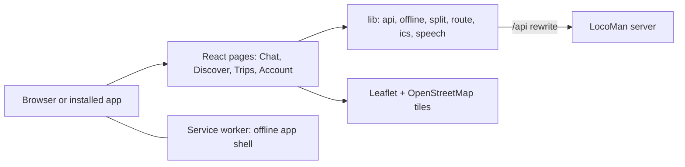

# LocoMan Client

LocoMan is an AI travel guide you can type or talk to.
Server: https://github.com/77sauravkr/Locoman-server

React, Vite, Tailwind CSS.

## Features

- Streaming replies with Markdown and Google Maps links for places
- Photo questions (pictures are resized in the browser and not stored)
- "Near me" with approximate location, only when switched on
- Voice messages and a hands-free live voice chat (replies are read by the browser)
- Saved chats with search, rename and delete; share or download a trip
- Dark mode, mobile layout, installable to the home screen
- Trips: AI or manual itinerary, edit, map pins, weather, booking search links
- Group trips by invite link, shared expenses and who-pays-whom
- Saved trips open offline (read-only)
- Discover: AI destination ideas for your budget, month and interests
- Ask AI to change a plan (preview first), shorten a day's route, packing list
- Calendar (.ics) export, print or save as PDF
- Group: live updates, voting and comments on places; public read-only trip page
- Travel kit: weather warnings, currency converter, emergency numbers, on-device ticket wallet
- Installable app (Android, desktop; on iPhone use Share, then Add to Home Screen)
- Password reset with a recovery code, optional Google sign-in, account deletion, privacy page

## Architecture



```text
src/App.jsx         session, routing, offline mode
src/components/     one file per page or trip tab
src/lib/            logic without React; split, route and calendar code is unit tested
src/hooks/          theme, voice recording, install prompt
public/sw.js        offline cache (never caches API responses)
vercel.json         /api rewrite, single-page fallback, security headers
```

Full system design and roadmap: [server ARCHITECTURE.md](https://github.com/77sauravkr/Locoman-server/blob/main/ARCHITECTURE.md).

## Run locally

Start the server first (see its README), then:

```bash
npm install
npm run dev     # http://localhost:5182
```

`npm run lint`, `npm test` and `npm run build` are what CI runs.

## Deploy (Vercel)

`vercel.json` forwards `/api/*` to the server, so the browser sees one origin and the login
cookie works. If the server URL changes, edit the `destination` there.
No environment variables are needed here. For Google sign-in, set `GOOGLE_CLIENT_ID` on the
server and add this site's address to the OAuth client's authorised JavaScript origins. Never add API keys to this project: anything the
client reads is public.
